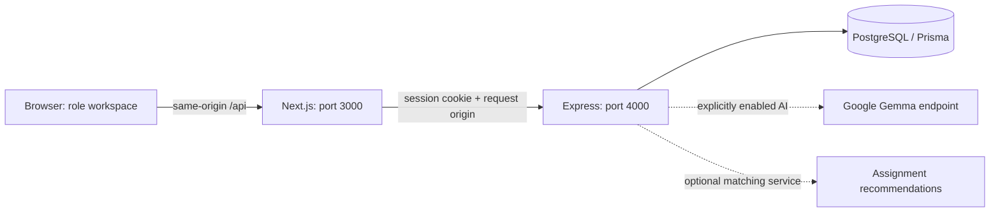

# CampusFix portals

CampusFix runs a Next.js frontend and a separate Express API against one PostgreSQL database. The Student, Manager and Technician workspaces share complaint records, assignments, repair reports and notifications. PostgreSQL is the runtime source of truth; the legacy SQLite file is only an optional development import source.

Gemma is enabled in the local runtime following user authorization to reuse the existing server credential. A real student complaint was analyzed successfully by Gemma and its validated result displayed in the browser. Credential values are not reproduced here or exposed in browser code. The example environment keeps AI disabled until an operator explicitly configures it; the maintenance lifecycle also works without AI, and a failed analysis never discards a submitted complaint.

## Architecture



| Area                      | Implementation                                                                                                                               |
| ------------------------- | -------------------------------------------------------------------------------------------------------------------------------------------- |
| Role entry pages          | `app/student/page.tsx`, `app/manager/page.tsx`, `app/technician/page.tsx` call the server-side role guard.                                   |
| Browser API boundary      | `lib/portal/backend.ts` and the Next.js catch-all API routes proxy requests to Express. Backend URL and provider secrets remain server-side. |
| Authentication            | `server/auth.ts` and `server/auth-routes.ts` implement passwords, database sessions, role checks and registration.                           |
| Student / Technician APIs | `server/portal-routes.ts` implements scoped reads, reporting, job actions, profiles and notifications.                                       |
| Manager API               | `server/manager-routes.ts` adapts the existing manager interface to the shared database and actions.                                         |
| Persistence               | `prisma/schema.prisma`, migrations, `server/db.ts`, and `server/store.ts`.                                                                   |
| State transitions         | `lib/manager/domain.ts` and technician action validation in `server/portal-routes.ts`.                                                       |
| AI                        | `server/ai.ts` authorizes and gates requests; `lib/manager/gemma.ts` calls Gemma and validates structured responses.                         |
| Shared portal UI          | `components/portal/ui.tsx` provides the shell, notifications, profile, image validation and snapshot polling.                                |

The schema stores users, rooms, hostels, technicians, sessions, complaint history, assignments, repair reports and parts, notifications and rate-limit counters as related records. Workspace settings and AI analysis are JSON. Complaint photos and completion photos are currently base64 data URLs stored in PostgreSQL arrays.

Maintenance writes run in transactions with a lock on workspace row `1`. Complaint actions include a `version`; stale versions return `409` instead of overwriting another actor’s changes. Workspace settings and technician management use a workspace `revision`. Provider calls run outside the workspace lock, and analysis checks the complaint version again before applying a result.

Student and technician snapshots refresh every 15 seconds while the page is visible and when the browser window regains focus. Updates are polling-based, not WebSocket delivery. Persisted notifications are scoped to the signed-in user, with up to 100 returned in the current feed.

## Access and lifecycle

This is a single operator workspace, not a tenant-isolated SaaS deployment. Every active manager can operate the complete property network in the database. Do not put unrelated organizations that require isolation in the same deployment.

| Role       | Access and controls                                                                                                                                                                                                                                          |
| ---------- | ------------------------------------------------------------------------------------------------------------------------------------------------------------------------------------------------------------------------------------------------------------ |
| Student    | Registers using a hostel invitation code and room; sees only complaints linked to their account; can report an issue in their enrolled hostel and view its status, history, technician and repair notes. Cannot assign, verify or directly reopen a repair.  |
| Technician | Registers with specializations and starts unverified/unavailable. A manager must verify the profile. Can accept or decline a current assignment, start an accepted job, add progress and submit a completion report. Cannot approve costs or verify repairs. |
| Manager    | Provisioned by the operator; public manager registration is rejected. Reviews complaints, selects eligible technicians, approves estimates, verifies completion and reopens or rejects issues with a reason.                                                 |

The technician snapshot retains jobs with a current or previous assignment to that technician. Direct job detail, AI advice and job mutations require the technician to be the current assignee. A previously assigned technician cannot continue modifying a job after reassignment. Repair history is retained when a complaint is reopened.

```text
Student report → Pending → manager approval → Approved
Approved → manager assignment → Assigned
Assigned → technician accepts → technician starts → In progress
In progress → technician completion report → Awaiting verification
Awaiting verification → manager estimate approval + verification → Completed

Assignment declined → Approved (manager can reassign)
Completed / Rejected / Awaiting verification → manager reopens → Reopened
Reopened → manager review or assignment → repair lifecycle continues
```

Assignment acceptance is separate from complaint status: accepting a job leaves it `Assigned`, and starting it changes the complaint to `In progress`. Submitting a report does not mark a repair verified. Verification requires an approved estimate that covers the report’s labour and parts total. Reopening preserves the earlier repair report and marks it with `reopenedAt`.

An eligible technician is verified, available, has a matching specialization and has fewer than four active assigned jobs. Built-in recommendations use specialization, straight-line distance, workload and stored reliability. They do not automatically assign technicians or provide travel-time estimates.

## Local development

Use Node.js 24–26 as declared in `package.json`, a PostgreSQL instance, and two terminal sessions for Next.js and Express. Run commands from the repository root.

```powershell
npm ci
npm run db:generate
npm run db:migrate
```

`db:migrate` applies the committed Prisma migrations. It requires `DATABASE_URL`; the application backend also refuses to start without that variable. The backend and Prisma CLI load `.env.local` followed by `.env` without overwriting environment variables already supplied by the shell.

The provisioned local PostgreSQL runtime is version 17.11, bound to `127.0.0.1:54329`, with data under `data/postgres`. Its helper scripts are local workspace files under the ignored `work/` directory, not portable installation scripts:

```powershell
.\work\postgres-local\manage.ps1 -Action Status
.\work\postgres-local\manage.ps1 -Action Start
. .\work\postgres-local\load.ps1
```

Dot-source `load.ps1` in each terminal that needs the local database connection. It loads the local connection settings into the current process without printing them. Do not copy `connection.json`, database files or credentials into source control. `manage.ps1 -Action Stop` stops this local PostgreSQL instance and should be used only after stopping applications that depend on it.

Start the API in one terminal:

```powershell
npm run dev:api
```

Start the frontend in another:

```powershell
npm run dev
```

The normal local URLs are `http://127.0.0.1:3000` for the frontend and `http://127.0.0.1:4000/health` for the API health check. Health checks execute a database query and return `503` if PostgreSQL is unavailable. Browser requests should use the frontend’s same-origin `/api` routes.

For this Windows environment, `node` may be available even when `npm`/`npx` are missing from `PATH`. Either add the installed Node/npm directory to the terminal’s `PATH` or invoke the bundled tools directly, for example `node node_modules/typescript/bin/tsc --noEmit` and `node --import tsx server/index.ts`.

### Development data

The demo seed requires a non-production environment, `SEED_DEMO=true`, and a development-only `DEMO_PASSWORD` of at least 12 characters:

```powershell
npm run db:seed
```

When the workspace is absent, the seed imports `LEGACY_SQLITE_PATH` (default `data/manager.sqlite`) read-only if it exists, or uses the development seed state. It creates one manager, two student accounts and three linked technician accounts. Account addresses are listed in `server/seed.ts`; passwords come from the local environment and are not documented here.

The demo seed preserves existing passwords on an existing account. It also sets hostel invitation codes to the demo invitation value, so it is exclusively for an isolated development database. Imported SQLite complaints are linked to the two development student accounts as disjoint test fixtures; that linking is not evidence of actual resident ownership and must not be used to assign real records to real users. The seed is not a general production migration or recovery command. Do not run integration tests against a production database.

### Initial real workspace

Use `server/bootstrap.ts` on an empty, migrated production database. It creates one real hostel, one operator manager and workspace settings, without sample complaints or technician accounts. It refuses to overwrite an existing workspace.

Supply these variables securely to the one-time bootstrap process:

| Variable                     | Validation                                                                                           |
| ---------------------------- | ---------------------------------------------------------------------------------------------------- |
| `BOOTSTRAP_MANAGER_EMAIL`    | Valid email; stored lowercased.                                                                      |
| `BOOTSTRAP_MANAGER_PASSWORD` | 16–128 characters.                                                                                   |
| `BOOTSTRAP_MANAGER_NAME`     | 2–80 characters.                                                                                     |
| `HOSTEL_NAME`                | 2–100 characters.                                                                                    |
| `HOSTEL_ADDRESS`             | 5–250 characters.                                                                                    |
| `HOSTEL_ROOMS`               | Integer from 1 through 5,000.                                                                        |
| `HOSTEL_INVITE_CODE`         | 16–100 characters; only its digest is stored.                                                        |
| `HOSTEL_LAT`, `HOSTEL_LNG`   | Optional coordinates; default to `0`. Supply real values before relying on distance recommendations. |

```powershell
npm run db:bootstrap
```

This command needs the project’s `tsx` development dependency in the operator/bootstrap environment. Its direct equivalent is `node --import tsx server/bootstrap.ts`. Remove bootstrap password variables from the normal application runtime after initialization. Share the invitation code through the hostel’s approved private channel. Public registration then permits students with that invitation and technicians awaiting manager verification.

## Environment reference

Never prefix these secrets with `NEXT_PUBLIC_` or place them in browser code.

| Variable                 | Purpose / default                                                                                                                                                                                        |
| ------------------------ | -------------------------------------------------------------------------------------------------------------------------------------------------------------------------------------------------------- |
| `DATABASE_URL`           | Required PostgreSQL connection string for the backend and migrations.                                                                                                                                    |
| `DATABASE_CA`            | Optional PEM certificate authority, with literal `\\n` converted to newlines; enables certificate verification for the PostgreSQL adapter.                                                               |
| `API_HOST`               | Backend bind address; defaults to `127.0.0.1`.                                                                                                                                                           |
| `API_PORT`               | Backend port; defaults to `4000`.                                                                                                                                                                        |
| `API_BASE_URL`           | Server-side Next.js → Express URL; defaults to `http://127.0.0.1:4000`. In production, non-loopback URLs must use HTTPS.                                                                                 |
| `APP_ORIGINS`            | Comma-separated exact frontend origins. Development defaults include `http://127.0.0.1:3000` and `http://localhost:3000`. Production requires explicit HTTPS origins and rejects `*`.                    |
| `TRUST_PROXY`            | Set to `1` only when Express is behind a controlled single proxy hop. Otherwise leave unset.                                                                                                             |
| `NODE_ENV`               | `production` enables secure cookies and production origin/URL restrictions.                                                                                                                              |
| `GEMMA_ENABLED`          | Must equal `true` before API AI routes call the provider. Enabled in the authorized local runtime; the example configuration defaults to `false`.                                                        |
| `GEMMA_API_KEY`          | Server-only Google provider credential. Configure only after the required authorization; never log or commit its value.                                                                                  |
| `GEMMA_MODEL`            | Defaults to `gemma-4-26b-a4b-it`; must match the supported `gemma-*` name pattern. The code rejects Gemini substitution. Account access and provider availability still require a live authorized check. |
| `SMART_ASSIGNMENT_URL`   | Optional external recommendation service; HTTPS required in production. Without it, built-in matching rules are used.                                                                                    |
| `SMART_ASSIGNMENT_TOKEN` | Optional server-only bearer token for that recommendation service.                                                                                                                                       |
| `SEED_DEMO`              | Set to `true` only for isolated demo/development data. Keep disabled in production.                                                                                                                      |
| `DEMO_PASSWORD`          | Development seed/test password, at least 12 characters.                                                                                                                                                  |
| `LEGACY_SQLITE_PATH`     | Optional read-only development import source; defaults to `data/manager.sqlite`.                                                                                                                         |

## HTTP API

All responses are JSON. Errors normally return `{ "error": "message" }`. Every state-changing request must carry an allowed `Origin`, including scripts that call Express directly. The frontend preserves the browser origin through its proxy. Authentication uses the `campusfix_session` cookie, not a token supplied in JSON.

### Authentication and shared data

| Method         | Path                                                         | Behavior                                                                                                                                                                                                                                |
| -------------- | ------------------------------------------------------------ | --------------------------------------------------------------------------------------------------------------------------------------------------------------------------------------------------------------------------------------- |
| `GET`          | `/api/health`, `/api/manager/health` or `/health` on Express | Public service/database readiness.                                                                                                                                                                                                      |
| `GET`          | `/api/auth/options`                                          | Public hostel IDs/names for registration and demo indicator.                                                                                                                                                                            |
| `POST`         | `/api/auth/register`                                         | Student/technician registration. Common fields: `email`, `password`, `role`, `name`, `phone`. Students also require `propertyId`, `room`, `inviteCode`; technicians require `specialization`. Public manager registration is forbidden. |
| `POST`         | `/api/auth/login`                                            | `{ email, password, role }`; issues a session and returns `{ user, redirect }`.                                                                                                                                                         |
| `POST`         | `/api/auth/logout`                                           | Revokes the current database session and clears its cookie.                                                                                                                                                                             |
| `GET`          | `/api/auth/me`                                               | Returns `{ user }` for an authenticated session.                                                                                                                                                                                        |
| `GET`, `PATCH` | `/api/profile`                                               | Current user; PATCH accepts exactly `{ name, phone }` and returns the public user. Login email/role cannot be changed here.                                                                                                             |
| `GET`          | `/api/notifications`                                         | Current user’s latest 100 persisted notifications.                                                                                                                                                                                      |
| `POST`         | `/api/notifications/read`                                    | `{ ids: string[] }`, 1–100 IDs; only owned notifications can be marked read.                                                                                                                                                            |

### Student

| Method | Path                                  | Behavior                                                                                                                                                                  |
| ------ | ------------------------------------- | ------------------------------------------------------------------------------------------------------------------------------------------------------------------------- |
| `GET`  | `/api/student`                        | `{ user, property, complaints, notifications, meta }`; complaint query is filtered by student ID.                                                                         |
| `GET`  | `/api/student/complaints`             | Current student’s complaints.                                                                                                                                             |
| `GET`  | `/api/student/complaints/:id`         | Owned complaint with repair, assignment and history information.                                                                                                          |
| `GET`  | `/api/student/complaints/:id/history` | Owned complaint’s audit history.                                                                                                                                          |
| `POST` | `/api/student/complaints`             | `{ title, description, category, propertyId, room, urgency, images }`; returns `201` with `{ complaint, aiError? }`. Reporter and student identity come from the session. |
| `POST` | `/api/ai/complaints/:id/analyze`      | `{ version }`; student ownership or manager role required. Returns the updated complaint, or a clear AI/configuration error.                                              |

Titles require 5–120 characters; descriptions require 10–2,500. The property must equal the student’s enrolled hostel. The room/location text supports 1–50 characters, including shared spaces. The UI labels `RO / Water` as “RO / Water Purifier” and `Lock repair` as “Locks”; the stored category values remain the existing manager taxonomy.

Complaint and repair photos accept up to three JPEG, PNG or WebP images, each at most 1 MiB. Browser checks validate type/count/size, and the backend checks decoded size and file signatures. The JSON body limit is approximately 4.5 MB. SVG and arbitrary remote image URLs are not accepted by the submission schema.

### Technician

| Method  | Path                               | Behavior                                                                                                                                                                             |
| ------- | ---------------------------------- | ------------------------------------------------------------------------------------------------------------------------------------------------------------------------------------ |
| `GET`   | `/api/technician`                  | User, technician profile, properties, current/prior assigned complaints, notifications and AI metadata.                                                                              |
| `GET`   | `/api/technician/jobs`             | Currently assigned complaints.                                                                                                                                                       |
| `GET`   | `/api/technician/jobs/:id`         | Current assigned job; another technician’s job returns `404`.                                                                                                                        |
| `GET`   | `/api/technician/history`          | Repair reports submitted by the current technician.                                                                                                                                  |
| `POST`  | `/api/technician/jobs/:id/actions` | `{ version, action, note?, report? }`; actions: `accept`, `decline`, `start`, `progress`, `complete`.                                                                                |
| `PATCH` | `/api/technician/profile`          | Optional `available`, `specialization`, `serviceArea`, `bio`. Availability requires verification. Changing specialties requires no active jobs and clears verification/availability. |
| `POST`  | `/api/ai/technician/:id/advice`    | Optional `{ question }`; `:id` is the complaint/job ID. Requires a verified current assignee.                                                                                        |

Decline and progress notes require at least five characters. Completion requires a `report` containing `summary`, `workPerformed`, non-negative `labour`, `parts` (`name`, positive integer `quantity`, non-negative `unitCost`), and optional `images`. Summary and work description must each contain at least ten characters. The backend rejects starting before acceptance, progress before starting, and any technician attempt to verify a repair.

### Manager

| Method   | Path                                             | Behavior                                                                                                                                     |
| -------- | ------------------------------------------------ | -------------------------------------------------------------------------------------------------------------------------------------------- |
| `GET`    | `/api/manager`                                   | Complete workspace snapshot and revision.                                                                                                    |
| `POST`   | `/api/manager/complaints`                        | Manager-submitted complaint, including `reporter`.                                                                                           |
| `PATCH`  | `/api/manager/complaints/:id`                    | Versioned `approve`, `reject`, `prioritize`, `reopen`, `assign`, `start`, `report`, `verify` or `estimate` action.                           |
| `GET`    | `/api/manager/complaints/:id/recommendations`    | Eligible technician recommendations.                                                                                                         |
| `POST`   | `/api/manager/complaints/:id/recommendations-ai` | `{ version }`; Gemma explanations/ranking of eligible candidates. Does not assign.                                                           |
| `POST`   | `/api/manager/complaints/:id/analyze`            | `{ version }`; manager alias for complaint analysis.                                                                                         |
| `POST`   | `/api/manager/assistant`                         | `{ question }`; advisory workspace summary.                                                                                                  |
| `PATCH`  | `/api/manager/technicians/:id`                   | `{ revision, verified?, available? }`; verifies and manages network availability.                                                            |
| `PATCH`  | `/api/manager/settings`                          | `{ revision, settings, properties }`; updates existing property IDs and settings. Login email changes require an operator identity workflow. |
| `DELETE` | `/api/manager/session`                           | Compatibility sign-out route for the existing manager UI.                                                                                    |

## Gemma behavior and configuration

The Next.js proxy routes declare a 60-second platform duration, with a 55-second upstream timeout. The implemented provider transport uses Google’s `generateContent` API with a Gemma model, a 45-second deadline and one retry on a server error. Responses are parsed as JSON and validated with Zod. Unknown complaint IDs, unknown/duplicate technician candidates, category/specialization mismatches and incomplete output are rejected. Errors preserve the difference between disabled AI, missing credentials, provider rejection, quota exhaustion and timeout. No fallback generates fabricated AI content.

Student submissions save first. With Gemma disabled or unavailable, they still return a saved complaint and an explanatory `aiError`. Authorized users can retry analysis from complaint details when configuration permits. Analysis can update category for Pending/Approved/Reopened complaints and can raise urgency; it does not lower an existing urgency, assign a technician or verify a repair.

Analysis sends issue title/description. Technician advice sends the job description, category, urgency, status, recorded repair notes and the question. Manager summaries include selected complaint context, including property and room identifiers; recommendation requests include eligible technician context. Photos are not submitted to Gemma by the current implementation. Decide whether this data transfer is appropriate before enabling the provider.

The credential checkpoint was resolved by explicit user authorization to reuse the existing key. The local runtime now uses `GEMMA_ENABLED=true`, and live student analysis for complaint `CF-1045` returned a validated Plumbing result displayed in the portal. New deployments should retain the example default `false` until an authorized operator configures the key/model and validates that deployment. Stored historical analysis or passing offline tests alone do not establish provider availability.

## Production deployment

Run Next.js and Express as separately supervised services with a persistent PostgreSQL database. A same-host layout can keep Express bound to loopback and expose only HTTPS for Next.js. For a remote API service, use an HTTPS `API_BASE_URL`; a plain HTTP container hostname is rejected by the current production URL check.

1. Install locked dependencies and generate the Prisma client with `npm ci` and `npm run db:generate`.
2. Supply production database settings and exact HTTPS `APP_ORIGINS`. Apply `npm run db:migrate` using deployment credentials authorized for schema changes.
3. On a new database only, run the bootstrap process described above. Existing deployments should not be reseeded.
4. Build with `npm run build:api` and `npm run build`.
5. Start the API with `npm run start:api` and Next.js with `npm run start`, both under `NODE_ENV=production` and process supervision. The API bundle keeps npm packages external, so production dependencies and the generated Prisma client must remain available.
6. Terminate TLS at a controlled proxy and preserve the intended frontend origin. Keep database and API listeners off public interfaces unless deployment controls require otherwise. Check database readiness through `/health` and authenticated operations through the frontend proxy.
7. Configure database backups and a tested restoration process, service restart policies, secret injection and deployment monitoring. These operational services are not installed by application code.

`Dockerfile.manager` packages the frontend and `Dockerfile.api` packages the API. A frontend image alone does not provision PostgreSQL or run Express. Use the current deployment files as they exist in the repository and validate the full multi-service configuration before releasing. Building successfully does not establish production readiness, provider availability or a successful hosted deployment.

The local PostgreSQL instance and `work/postgres-local` scripts are development conveniences. They are not a managed production database, backup system or high-availability setup.

## Security controls and current limits

Implemented controls include:

- Salted scrypt password hashes (`N=32768`, `r=8`, `p=1`), constant-time hash comparison, and no plaintext password persistence.
- Cryptographically random session tokens; only SHA-256 token digests are stored in PostgreSQL. Sessions expire after seven days and are invalidated on logout. Cookies are HttpOnly, SameSite=Strict, and Secure in production.
- Backend role checks and ownership/assignment checks in addition to page redirects. Unauthorized foreign complaints return `404` where ownership must not be disclosed.
- Explicit allowed origins for state-changing requests, rejection of cross-site fetches, credentialed CORS with exact origins, Helmet headers on Express and `no-store` API responses.
- Database-backed throttling for login, registration, student reporting and AI calls. Counters survive process restarts and are shared by API replicas using the database.
- Server validation of payloads, image signatures and upload sizes, optimistic concurrency checks and transactional write history.
- Backend errors avoid logging raw database/provider exceptions, bodies, cookies or credentials. Secret values are not included in API metadata.

Current limitations to account for:

- One workspace row and manager-wide authority provide no independent organization/tenant isolation. The workspace write lock also serializes maintenance mutations; this favors consistency over large-scale throughput.
- Password reset/change, email verification, MFA, self-service account deletion, invitation rotation and a complete operator identity-management interface are not implemented.
- The public registration options endpoint exposes hostel names/IDs. The invitation code authorizes student enrollment; the app does not independently verify resident identity or room occupancy.
- Session expiry is fixed rather than sliding. Operational revocation and account deactivation need operator/database procedures beyond the current portal forms.
- The current proxy does not forward arbitrary client IP headers. IP throttling observes the backend request address, so shared-proxy traffic may share an IP quota. Per-user AI/report and per-email login counters still apply. Review proxy trust and rate limits for the deployment topology.
- Images are stored in database payloads and checked by signature/size; there is no malware scanner, image re-encoding, EXIF stripping, object-storage lifecycle or automated retention policy.
- Snapshot responses load complaint lists rather than using server-side pagination. Browser filtering/pagination does not reduce database response volume. Notifications currently expose only the latest 100 entries.
- Assignment distances are straight-line estimates using stored coordinates, and profile ratings/reliability are stored values rather than a newly implemented reputation-calculation system.
- Notifications are in-app database records. Email, SMS, push delivery, payment processing and an emergency dispatch service are not implemented.
- AI is advisory and can still be wrong despite schema validation. It cannot establish that a repair happened, was safe or was verified. Manager verification remains the completion authority.

## Verification and troubleshooting

Available checks:

```powershell
npm run typecheck
npm run lint
npm test
npm run test:integration
npm run build:api
npm run build
npm run test:production
```

The PostgreSQL integration suite in `tests/portals.test.ts` runs against the configured development database and seeded demo accounts. It explicitly sets `GEMMA_ENABLED=false`. Its six scenario subtests plus their enclosing lifecycle test produce seven reported tests. They cover authentication/role isolation, registration/verification, own-complaint access, complaint persistence during disabled AI, assignment/acceptance/progress, stale writes, completion/estimate verification, notifications, reopening/decline and logout. It removes records it creates, while existing development records remain.

`test:production` runs `tests/production-smoke.mts` after both production builds exist. It requires a local PostgreSQL account that can create and drop a temporary test database, and free ports `3107` and `4107`. It starts built services with production settings and AI disabled, exercises the frontend proxy and session behavior, and removes only its randomly named test database on exit. It is a local production-mode smoke test, not a hosted deployment or browser TLS test.

At documentation time, all seven reported PostgreSQL integration tests and ten unit tests passed. The production smoke test also passed, including a fresh database bootstrap and session persistence after server restart. The student/shared UI passed scoped ESLint with no warnings and a whole-repository TypeScript check. Live student Gemma analysis was verified in the browser. Real technician Gemma advice and a summary of an existing repair report also passed in the browser. Complaint CF-1045 completed the full browser workflow from student reporting through manager assignment, technician acceptance/start/progress/completion (including a test PNG and ₹350 in labour/parts), and manager verification. Mobile technician layout and its report form passed at 390 px with no horizontal overflow. This document makes no claim of a hosted production deployment.

| Symptom                                                        | Check                                                                                                                                      |
| -------------------------------------------------------------- | ------------------------------------------------------------------------------------------------------------------------------------------ |
| “Backend did not respond” / authentication service unavailable | Start Express and PostgreSQL; confirm `API_BASE_URL`, `/health`, bind address and ports.                                                   |
| Mutation returns `403` for origin                              | Match the browser’s exact origin, including protocol/port, in `APP_ORIGINS`. Scripts must send an allowed `Origin`.                        |
| Student/technician cannot enter manager workspace              | Expected role isolation; sign in with the correct account and selected role.                                                               |
| Technician cannot become available                             | Manager verification is required; changing specializations clears verification.                                                            |
| Job action returns `409`                                       | Refresh the snapshot and confirm the current state/version. Acceptance must precede start; start must precede progress/completion.         |
| Verification rejected                                          | The complaint must await verification and have an approved estimate covering the submitted repair total.                                   |
| Complaint saved but AI unavailable                             | The complaint is retained. Check AI enablement, credentials, model access, quota and provider errors; the manager can continue without AI. |
| Login cookie missing in production                             | Use HTTPS; verify Set-Cookie is preserved by the frontend/proxy and production origin settings are correct.                                |
| Invalid/oversized image                                        | Use a valid JPEG, PNG or WebP under 1 MiB; at most three per report.                                                                       |
| Demo seed refuses to run                                       | It is intentionally blocked in production and without `SEED_DEMO=true` and a valid development password.                                   |
